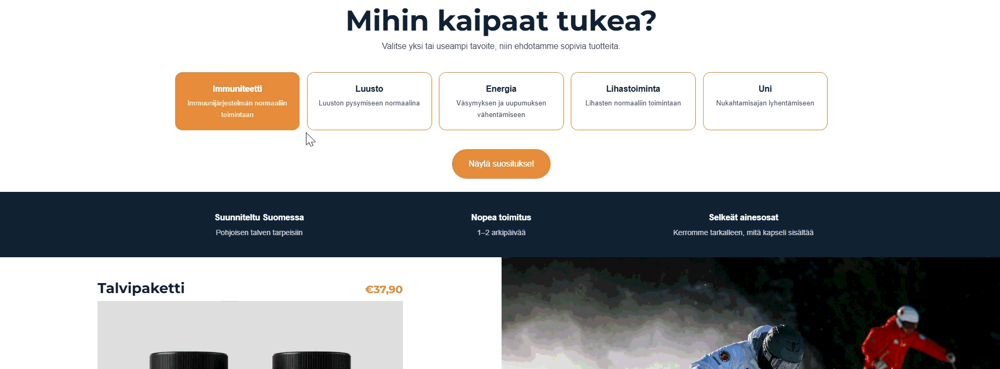

# Kaamos Nutrition – custom Shopify sections

Custom theme sections built for **Kaamos Nutrition**, a fictional Finnish supplement brand I created as a Shopify demo store. The store is built on Shopify's current default theme; this repo contains only the code I wrote myself.

## Sections

### 1. Goal-based product finder (`sections/kaamos-goal-finder.liquid`)

A two-step quiz: the shopper picks one or more wellbeing goals and gets ranked product recommendations with an add-to-cart button.

- **Driven by product data, not hard-coded:** each product's goals live in a metafield (`custom.tavoitteet`, list of single line text). Add a goal to a product in the admin and it appears in the recommendations automatically.
- **Ranking:** products are scored by how many of the selected goals they match, with the collection's sort order as the tiebreaker. A product that clearly beats the runner-up gets a "best match" badge, so multi-goal bundles naturally rise to the top.
- **Merchant-editable:** goals are theme editor blocks, so they can be added, renamed and reordered without code. The source collection, result count, colours and all texts are section settings. The metafield namespace and key are settings too, so the section can be dropped into another store.
- **Progressive enhancement:** add to cart is a standard Shopify product form, so it still works if JavaScript fails.
- **Accessible:** goal buttons use `aria-pressed`, results are announced through an `aria-live` region, and focus moves to the results heading.
- **Modern theme patterns:** a scoped custom element (`<kaamos-goal-finder>`), section-level `` and ``, and no external dependencies.

### 2. Trust strip (`sections/kaamos-trust-strip.liquid`)

A small, fully editable band of reasons to buy (for example "Designed in Finland" or "Delivery in 1–3 working days"). Up to four items as blocks, with configurable colours.

## Installation

1. Copy the files from `sections/` into your theme's `sections/` folder (with Shopify CLI: `shopify theme dev` to preview, `shopify theme push` to upload).
2. **For the product finder,** create a product metafield definition under *Settings → Metafields and metaobjects → Products*:
   - Type: **List of choice list(Single line text)** 
   - Give the name of the metafield and add the goal options
3. Fill in the goals on your products.
4. In the theme editor, add the section *Kaamos: tuotesuosittelija* and choose the collection to recommend from.
5. Make sure each goal block's **metafield value** matches the values used on your products exactly.

## Compliance by design

Food supplement marketing in the EU is regulated: health claims must come from the EU Register of authorised claims (Regulation (EC) No 1924/2006 and (EU) No 432/2012). The finder was designed with this in mind:

- every goal is based on an authorised claim for a nutrient in the catalogue, and the default goal descriptions follow that claim's wording (for example "Väsymyksen ja uupumuksen vähentämiseen" for magnesium's tiredness and fatigue claim)
- goal names avoid implying benefits that no authorised claim covers (for example "Lihasten normaaliin toimintaan" instead of "recovery")
- the goal description setting reminds the merchant to use only authorised wording

Known limitation: general references like "Immunity" are only allowed when accompanied by a specific authorised claim that names the nutrient. In this demo, those specific claims are on the product pages, not in the finder itself. For a live store, the next step would be to show each recommended product's authorised claims on its result card, for example from a product metafield.

Multilingual pitfall: auto-translation also translated technical keys (metafield key, goal values), which silently broke the recommendations in English. Diagnosed with debug output in Liquid. Fixed by keeping technical values language-independent.

This is a demo, not legal advice: a real store should have its claims reviewed by the merchant or a food law expert.

## Tech

Liquid · Shopify Online Store 2.0 sections and blocks · metafields · vanilla JavaScript (custom elements) · CSS · Shopify CLI

## About

Built by Maxim Anikin, a Shopify developer with a background in wellness marketing, based in Finland.
Contact: anikintech@gmail.com · Demo store: (https://kaamos-nutrition.myshopify.com/) (password available on request)